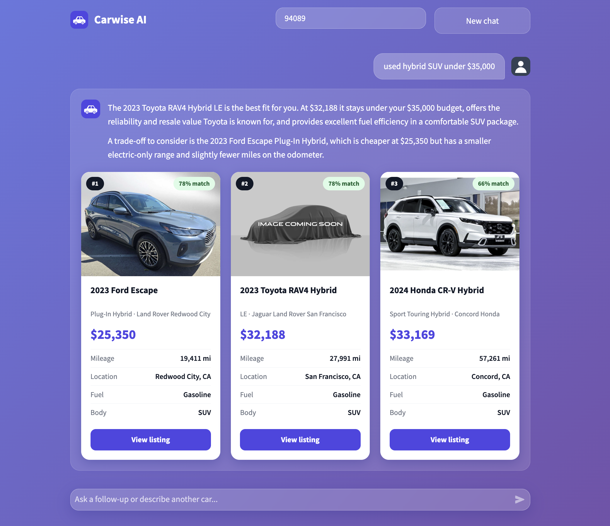
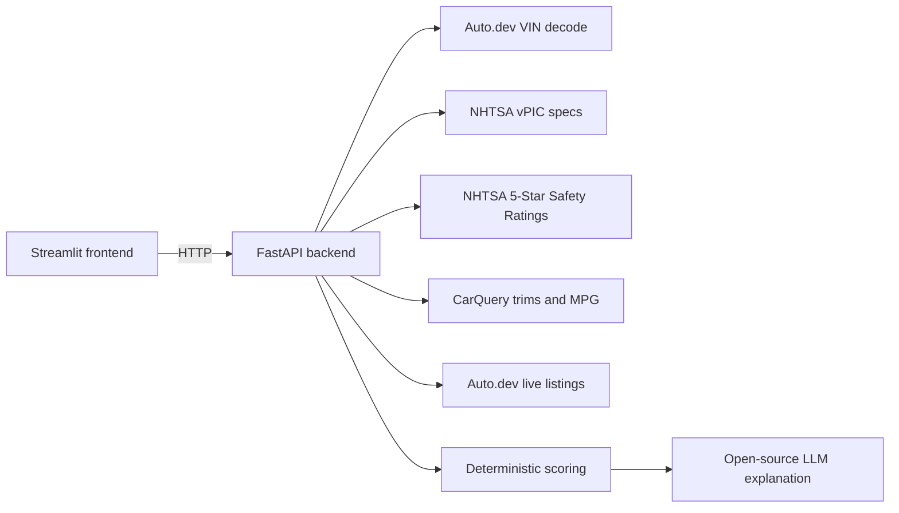

# CarWise AI

A GenAI car-shopping assistant. CarWise combines a VIN decoder, government safety data, and live dealer listings into a single backend, ranks cars with a **transparent weighted scoring model**, and uses an open-weight LLM (gpt-oss via Groq by default, or any model through Ollama) only to *explain* the results in plain language, so the LLM never has to invent numbers.

Built as a team capstone project (Python, FastAPI, Streamlit). **My role:** backend and API integration, including the external data pipeline, the scoring and search logic, and the LLM prompting layer.

   

## Features

- **VIN lookup:** decodes a VIN and merges data from four sources into one normalized car profile (year, make, model, trim, engine, fuel economy, safety rating).
- **Variety, not repeats:** the top three results are chosen to be different models when the listings allow it (for example a GR86, a Supra and a 370Z), instead of the same car at three dealers.
- **Explainable recommendations:** `/search` filters and ranks live listings with a five-factor score and returns the per-factor breakdown with every result.
- **Conversational assistant:** `/chat` answers questions about a specific VIN, or turns a free-text request ("family SUV under $30k") into structured filters, searches, and explains the top matches.
- **Grounded LLM output:** the model receives structured data and filters computed by the backend, and a system prompt that tells it to say "I don't have that information" instead of guessing.
- **Any fuel type, brand or model:** ask for a hybrid, plug-in, electric, diesel or gas car, or name a brand or model ("used Honda Civic", "Tesla Model 3 under $40k"). Auto.dev labels many hybrids as "Gasoline", so CarWise also checks the model and trim and a small table of hybrid-only and EV-only models instead of trusting the fuel field alone.
- **"Near me" searches:** enter your ZIP code and the backend passes it to Auto.dev with a search radius (50 miles by default). Asking for "nearby" cars without a ZIP gets a prompt for one.
- **Streamlit UI:** a search-first interface with quick-start prompts and conversation memory. Each top match is a clickable card with the live listing photo, price, mileage, MPG, distance, and a match score, and clicking it opens the dealer's listing page in a new tab.

## How it works



**Data pipeline.** `get_car_profile_from_vin` calls Auto.dev (identity), NHTSA vPIC (engine specs), CarQuery (trims and fuel economy, converted to MPG) and the NHTSA Safety Ratings API (star rating), then normalizes them into a `CarProfile` Pydantic model. VIN decodes are cached in memory for 24 hours.

**Scoring.** Each listing gets five sub-scores from 0 to 1, combined with fixed weights:

| Factor | Weight | Notes |
| --- | --- | --- |
| Price | 30% | Full score at or under budget; decays quickly when over |
| Mileage | 25% | Full score up to 30k miles, declining to 120k+ |
| Fuel economy | 20% | City/highway blend, scaled from 20 to 35 MPG |
| Distance | 15% | Full score within the requested radius |
| Safety | 10% | NHTSA stars divided by 5 |

Missing data gets a neutral 0.5 rather than being silently dropped. The logic lives in [`app/search.py`](app/search.py) and is covered by unit tests.

**LLM layer.** In chat mode the model extracts filters from the request, the backend runs the search and scoring, and the model then writes a short recommendation from the structured results. Conversation history (last 10 messages) is passed along so follow-ups work.

> **Live data only:** results always come from Auto.dev's live listings, with no demo or placeholder cars. If the listings service is down the assistant says so, and if nothing matches it says that instead of guessing.

## Tech stack

Python, FastAPI, Pydantic, Uvicorn, Requests, Streamlit, any OpenAI-compatible LLM API (open-weight models via Groq or Ollama), Auto.dev, NHTSA vPIC, NHTSA Safety Ratings, CarQuery, pytest, GitHub Actions.

## Getting started

**Prerequisites:** Python 3.10+, an [Auto.dev](https://auto.dev) API key, and an LLM: either a free [Groq](https://console.groq.com/keys) API key, or [Ollama](https://ollama.com) running locally (no key needed).

```bash
git clone https://github.com/FrankOceanLover-MK/GenAI---Capstone-Project.git
cd GenAI---Capstone-Project

python -m venv .venv
source .venv/bin/activate        # Windows: .venv\Scripts\activate
pip install -r requirements.txt

cp .env.example .env             # then add your API keys and choose an LLM option
```

### Choosing an LLM

CarWise talks to any OpenAI-compatible endpoint, so you can swap models by editing `.env`, with no code changes:

| Option | Setup | Notes |
| --- | --- | --- |
| **Groq** (default) | Free key from console.groq.com, set `LLM_API_KEY` | Fast, no GPU needed, rate-limited free tier. Default model `openai/gpt-oss-120b`; use `openai/gpt-oss-20b` for more speed. Groq's model lineup changes, so list what your key can use with the `curl` command in `.env.example` |
| **Ollama** (local) | Install Ollama, `ollama pull llama3.1:8b`, set `LLM_BASE_URL=http://localhost:11434/v1` | Fully free and private, speed depends on your hardware |
| Others | OpenRouter, Together, Cerebras, LM Studio, vLLM | Set `LLM_BASE_URL`, `LLM_MODEL`, `LLM_API_KEY` |

Run the backend:

```bash
uvicorn app.main:app --reload
```

Interactive API docs are at <http://127.0.0.1:8000/docs>.

Run the frontend in a second terminal:

```bash
cd frontend
pip install -r requirements.txt
streamlit run streamlit_app.py
```

See [`frontend/README.md`](frontend/README.md) for details, including how to point the UI at a different backend URL.

## API overview

| Method | Endpoint | Description |
| --- | --- | --- |
| GET | `/health` | Health check |
| GET | `/cars/{vin}` | Full normalized car profile for a VIN |
| GET | `/cars/{vin}/summary` | Short text summary of a VIN |
| POST | `/search` | Filter and rank listings with a score breakdown |
| POST | `/chat` | Conversational assistant (VIN mode or discovery mode) |
| GET | `/recommendations` | Query-string version of the search |

Example:

```bash
curl -X POST http://127.0.0.1:8000/search \
  -H "Content-Type: application/json" \
  -d '{"budget": 26000, "max_distance": 60, "body_style": "SUV"}'
```

## Tests

```bash
pip install -r requirements-dev.txt
pytest
```

Unit tests cover the scoring functions, filters (including fuel, make and model matching), ranking, de-duplication and paged fetching, and run without network access or API keys. `scripts/smoke_test_apis.py` is a manual check against the real external APIs, and `python -m scripts.make_avatars` regenerates the chat avatar icons, and `python -m scripts.inspect_listing` shows which photo and link fields your Auto.dev plan returns.

## Project structure

```
app/
  main.py            FastAPI app and endpoints
  external_apis.py   Auto.dev, NHTSA, CarQuery clients and profile builder
  search.py          Filtering and weighted scoring
  llm_client.py      Provider-agnostic client for any OpenAI-compatible LLM endpoint
  llm_prompts.py     System prompt and prompt builders
  schemas.py         Pydantic models
frontend/            Streamlit UI (assets/ holds the original avatar icons)
tests/               pytest suite
scripts/             Manual checks (smoke_test_apis.py, inspect_listing.py)
```

## Limitations and future work

- **Live inventory is sampled, not exhaustive.** The Auto.dev Free plan returns 20 listings per request, and CarWise filters and ranks only the newest listings it reads: about 60 for a normal search (`AUTO_DEV_PAGES=3`) and about 120 when you ask for a specific fuel type, brand or model (`FUEL_SEARCH_PAGES=6` in `app/search.py`). Common cars return plenty of results, but rarer ones (a specific EV, an uncommon trim) can return few or none even when more exist on dealer sites. A paid Auto.dev plan with larger pages, or a server-side fuel filter, would widen the pool.
- **Fuel type is inferred.** Hybrids and plug-ins are detected from the model, trim and a hand-maintained table of hybrid-only and EV-only models, so a brand-new model may be missed until the table is updated.
- **Brand and model come from the LLM.** Filters are extracted by the model from your message, so unusual phrasing can drop one. The ranking itself is deterministic and never uses the LLM.
- **Results are capped at three** so the written recommendation and the cards always describe the same cars.
- Extra pages are fetched in parallel, which keeps searches fast but uses more of your Auto.dev quota per question and can hit rate limits (a refused page is skipped).
- The in-memory cache resets when the server restarts; Redis would be a natural next step.
- Weights are fixed; letting users adjust them (for example "I care more about safety") would be a good extension.
- Filter extraction relies on the LLM returning valid JSON and falls back to no filters if it doesn't; a stricter JSON schema (or the API's structured-output mode) would make it more reliable.

## License

MIT. See [LICENSE](LICENSE).
